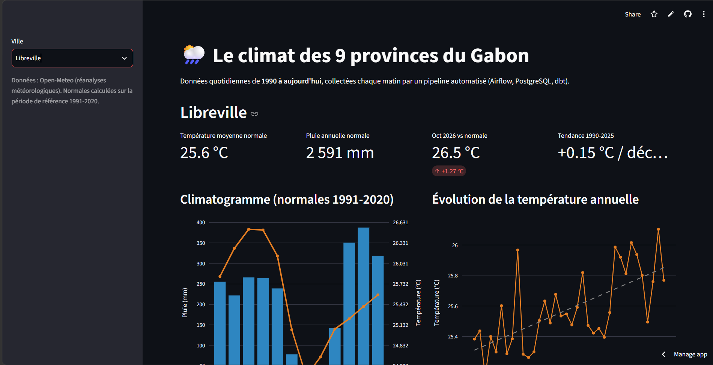
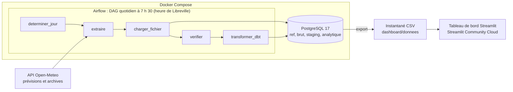
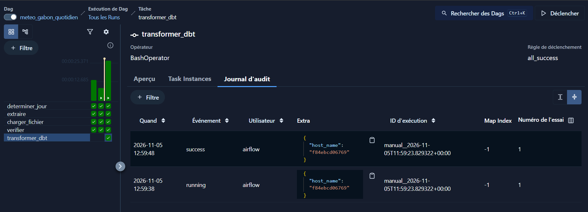
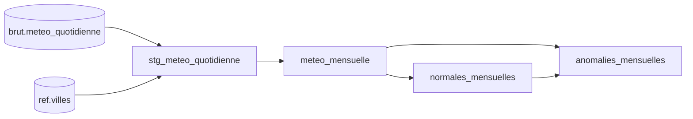

# Pipeline météo du Gabon


Pipeline de données de bout en bout qui collecte chaque matin la météo des **9 chefs-lieux de province du Gabon**, la stocke dans PostgreSQL, la transforme avec dbt et l'affiche dans un tableau de bord public.

**[Voir le tableau de bord en ligne](https://climat-gabon.streamlit.app)**



## Ce que montrent les données

- **Plus de 121 000 relevés quotidiens** depuis le 1er janvier 1990, pour Libreville, Port-Gentil, Franceville, Oyem, Lambaréné, Mouila, Tchibanga, Makokou et Koulamoutou.
- **Libreville se réchauffe d'environ +0,15 °C par décennie** sur 1990-2025, soit un peu plus de 0,5 °C en 36 ans.
- **9 des 10 mois les plus anormalement chauds** depuis 1990 (toutes villes confondues) datent des dix dernières années. Les pics de janvier et février 2016 correspondent au fort épisode El Niño de 2015-2016.
- **Un fort contraste de pluie entre provinces** : Mouila et Libreville reçoivent plus de 2 500 mm par an, contre environ 1 600 mm à Koulamoutou et Makokou.
- Le climatogramme de Libreville fait ressortir les **deux saisons des pluies** (mars à mai, octobre à décembre) et la **grande saison sèche** de juin à août.

## Architecture



1. **Collecte** : un module Python interroge l'API Open-Meteo pour les 9 villes, avec réessais automatiques en cas d'erreur temporaire.
2. **Chargement** : les données sont insérées dans PostgreSQL par *upsert* (`ON CONFLICT ... DO UPDATE`). Relancer un traitement ne crée jamais de doublons.
3. **Contrôle** : le DAG vérifie que les 9 villes sont présentes pour la journée avant d'aller plus loin.
4. **Transformation** : dbt construit les tables analytiques et exécute les tests de qualité.
5. **Restitution** : les tables analytiques sont exportées en CSV et alimentent le tableau de bord publié en ligne.



## Stack technique

| Rôle | Outil |
|---|---|
| Langage | Python 3.12, SQL |
| Gestion de l'environnement | uv |
| Orchestration | Apache Airflow 3.3 (TaskFlow API) |
| Stockage | PostgreSQL 17 |
| Transformation et tests de données | dbt 1.12 |
| Conteneurisation | Docker, Docker Compose |
| Visualisation | Streamlit, Plotly |
| Qualité du code | pytest, Ruff |

## Modèle de données

| Schéma | Contenu | Format |
|---|---|---|
| `ref` | `villes` : les 9 chefs-lieux, leur province et leurs coordonnées | Table |
| `brut` | `meteo_quotidienne` : une ligne par ville et par jour, avec la source et l'heure de collecte | Table |
| `staging` | `stg_meteo_quotidienne` : colonnes renommées, unités explicites, province ajoutée | Vue |
| `analytique` | `meteo_mensuelle`, `normales_mensuelles` (période de référence 1991-2020), `anomalies_mensuelles` | Tables |

Lignage des transformations dbt :



## Qualité et fiabilité

- **Chargement idempotent** : la clé primaire `(ville, date)` et l'upsert garantissent une seule ligne par ville et par jour.
- **Réessais** : côté collecte (3 tentatives avec attente progressive) et côté Airflow (2 relances par tâche).
- **Contrôle avant transformation** : dbt ne tourne que si les 9 villes ont bien été chargées.
- **12 tests de données dbt** : valeurs non nulles, valeurs acceptées, unicité par ville et par jour ou par mois, cohérence des températures (minimale ≤ moyenne ≤ maximale), valeurs physiquement plausibles, normales calculées sur exactement 30 ans.
- **Fraîcheur des données** : alerte si aucune donnée n'a été chargée depuis 2 jours.
- **10 tests unitaires pytest** sur la collecte, le chargement et le découpage de l'historique.
- **Secrets hors du code** : identifiants dans un fichier `.env` jamais versionné.

## Structure du projet

```
pipeline-meteo-gabon/
├── dags/                      # DAG Airflow quotidien
├── dashboard/
│   ├── app.py                 # Tableau de bord Streamlit
│   ├── donnees/               # Instantané CSV des tables analytiques
│   └── requirements.txt       # Dépendances pour Streamlit Cloud
├── sql/                       # Création des bases et des schémas
├── src/pipeline_meteo_gabon/
│   ├── config.py              # Les 9 villes et leurs coordonnées
│   ├── extract.py             # Collecte depuis l'API Open-Meteo
│   ├── load.py                # Chargement idempotent dans PostgreSQL
│   ├── backfill.py            # Chargement de l'historique année par année
│   └── export.py              # Export des tables analytiques en CSV
├── tests/                     # Tests unitaires pytest
├── transformations/           # Projet dbt (modèles, tests, macros)
├── Dockerfile                 # Image Airflow avec le package et dbt
└── docker-compose.yml         # PostgreSQL et Airflow
```

## Lancer le projet

Prérequis : Docker, [uv](https://docs.astral.sh/uv/) et Git.

```bash
git clone https://github.com/onelngoma-source/pipeline-meteo-gabon.git
cd pipeline-meteo-gabon
cp .env.example .env          # puis choisir un mot de passe et vérifier AIRFLOW_UID (commande : id -u)
uv sync
docker compose up -d --build
```

Charger l'historique depuis 1990 (2 à 4 minutes) :

```bash
uv run python -m pipeline_meteo_gabon.backfill
```

Construire les tables analytiques et lancer les tests de données :

```bash
uv run --env-file .env dbt build --project-dir transformations --profiles-dir transformations
```

Interface Airflow : [http://localhost:8080](http://localhost:8080). Activer le DAG `meteo_gabon_quotidien` pour la collecte automatique de chaque matin.

Tableau de bord en local :

```bash
uv run --env-file .env python -m pipeline_meteo_gabon.export
uv run --group dashboard streamlit run dashboard/app.py
```

Tests unitaires et qualité du code :

```bash
uv run pytest
uv run ruff check .
```

## Limites et pistes d'amélioration

- **Origine des données** : Open-Meteo fournit des réanalyses météorologiques (modèles), et non des relevés de stations au sol. Elles conviennent aux comparaisons et aux tendances, mais peuvent différer des mesures locales.
- **Significativité de la tendance** : la tendance est une régression linéaire simple ; un test statistique (par exemple Mann-Kendall) permettrait de confirmer qu'elle n'est pas due au hasard.
- **Mise à jour du tableau de bord** : l'export CSV est lancé manuellement ; il pourrait devenir une tâche du DAG.
- **Déploiement d'Airflow** : le mode `standalone` convient à un projet personnel ; en production, les composants seraient séparés et l'authentification activée.
- **Intégration continue** : lancer automatiquement pytest, Ruff et dbt à chaque `push` avec GitHub Actions.

## Auteur

**Onel NGOMA**, étudiant en Big Data et Intelligence Artificielle, Libreville.
GitHub : [onelngoma-source](https://github.com/onelngoma-source)

Données météo : [Open-Meteo](https://open-meteo.com/).